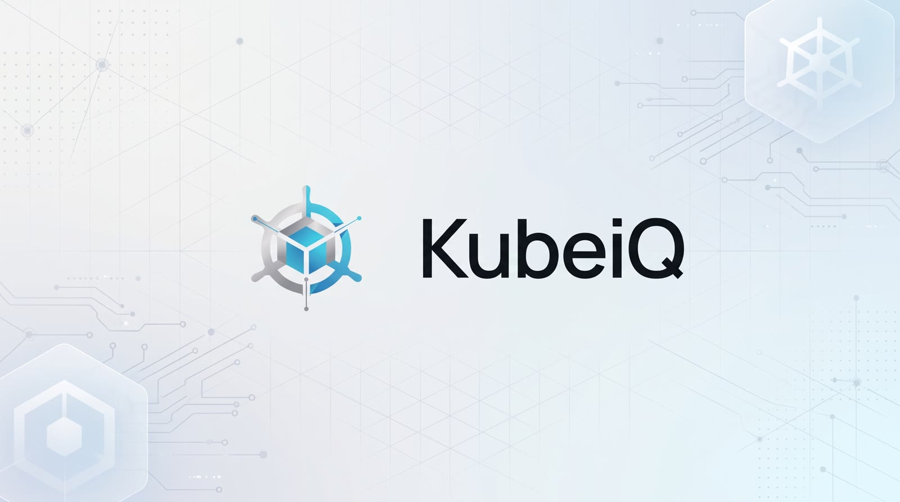
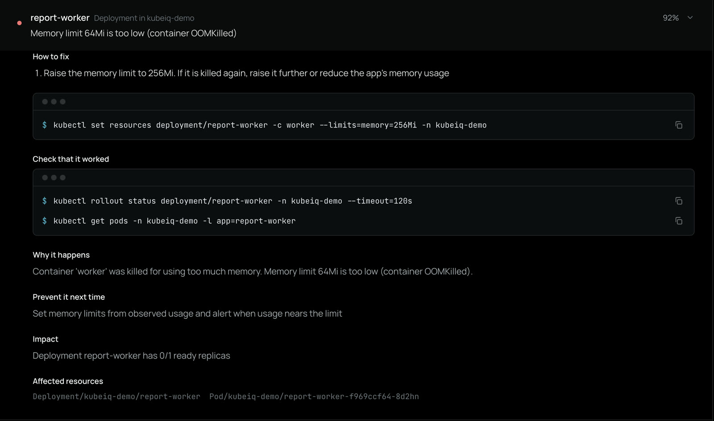
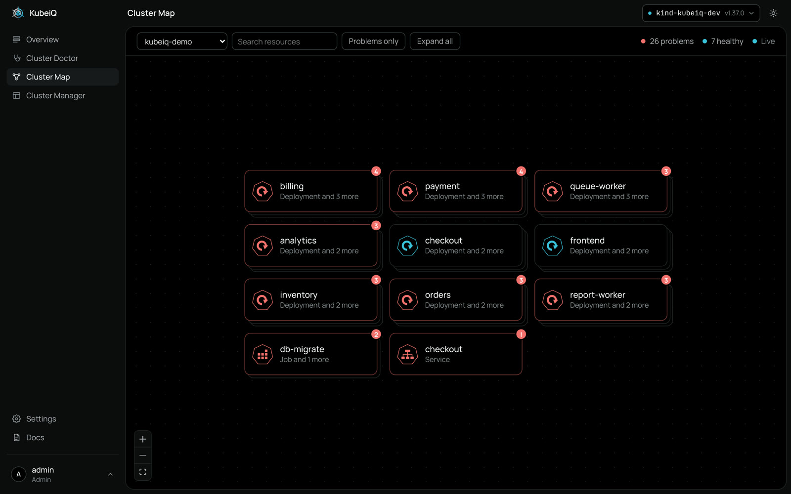
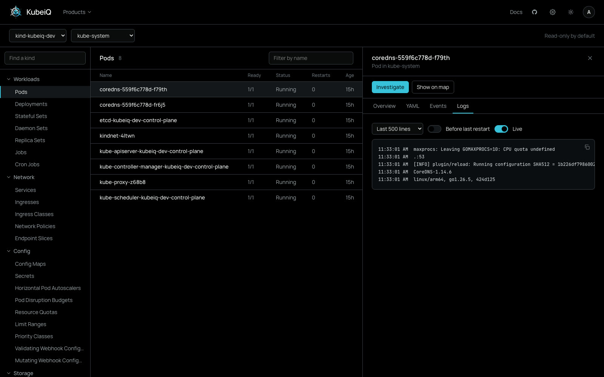
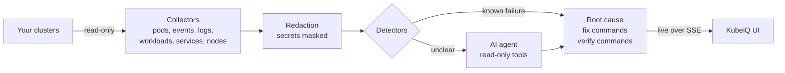

<p align="center">
  
</p>

<h3 align="center">Find out why your Kubernetes workloads break, and get the exact command to fix them.</h3>

<p align="center">
  Open-source, self-hosted AI for Kubernetes operations. One install, every tool, any model.
</p>

<p align="center">
  <a href="https://github.com/Ahmedwagdymohy/KubeiQ/actions/workflows/ci.yml"></a>
  <a href="LICENSE"></a>
  
  
  <a href="https://github.com/Ahmedwagdymohy/KubeiQ/stargazers"></a>
</p>

<p align="center">
  <a href="#quick-start">Quick Start</a> ·
  <a href="#products">Products</a> ·
  <a href="#how-it-works">How It Works</a> ·
  <a href="#configuration">Configuration</a> ·
  <a href="docs/ROADMAP.md">Roadmap</a> ·
  <a href="CONTRIBUTING.md">Contributing</a>
</p>

<p align="center">
  
</p>

## Why KubeiQ

A pod is in `CrashLoopBackOff` at 3 a.m. You open a terminal, run `describe`, read events, pull
previous logs, check the ConfigMap, then the Secret. KubeiQ does that walk for you and answers with
one line and one command:

```text
payment  Deployment in kubeiq-demo                                        94% sure
Environment variable DATABASE_URL is missing

$ kubectl set env deployment/payment DATABASE_URL=<database-url> -c app -n kubeiq-demo
$ kubectl rollout status deployment/payment -n kubeiq-demo --timeout=120s
```

- **Root cause, not symptoms.** One line naming the exact resource and setting, with the evidence
  behind it and a confidence score.
- **Commands you can paste.** Filled with your real names and values. Placeholders only for what
  KubeiQ cannot know, named for what they hold.
- **Proof it worked.** Every fix comes with the commands that verify it on the workload.
- **Yours to run.** Self-hosted, read-only by default, secrets masked before any model sees them,
  and it works with any model or with no model at all.

> [!NOTE]
> KubeiQ is in active development. The core is usable today; see the [roadmap](docs/ROADMAP.md)
> for what is next.

## Quick Start

You need **Docker** (with Compose v2), **git** and a **kubeconfig** for the clusters you want to
read. Then run:

```bash
curl -fsSL https://raw.githubusercontent.com/Ahmedwagdymohy/KubeiQ/main/deploy/install.sh | sh
```

The installer clones KubeiQ into `~/kubeiq`, generates a master key and the database password,
pulls the images and starts everything with Docker Compose. When it finishes:

1. Open **http://localhost:3000** (or this server's address) and sign in as `admin` with the
   master key the installer prints (it is also saved as `KUBEIQ_MASTER_KEY` in
   `~/kubeiq/backend/.env`). The first sign-in walks you through creating a project and adding
   its clusters. The free plan includes 3 users, 1 project and 3 clusters.
2. Open **Cluster Doctor**, pick a cluster and a namespace, and run an investigation.
3. Optional: open **Settings** to add an AI model, upload more kubeconfigs and invite your team.

| Task | Command |
|------|---------|
| Use another port | `export KUBEIQ_PORT=3001` before running the installer |
| Serve over HTTPS | `export KUBEIQ_DOMAIN=kubeiq.example.com` (DNS pointing at the server, ports 80 and 443 open) |
| Install a release | `export KUBEIQ_REF=v0.1.0` |
| Update | Run the installer again |
| Logs | `cd ~/kubeiq && docker compose logs -f` |
| Stop | `cd ~/kubeiq && docker compose down` |
| Run from a clone | `docker compose up --build` |

### Running in Production

The installer sets up a production stack, not a demo:

- **One entry point.** A Caddy proxy serves the app and the API on one port. The API and the
  database are not published. Set `KUBEIQ_DOMAIN` and Caddy gets a Let's Encrypt certificate.
- **Postgres** with its own volume. To use your own Postgres, set `KUBEIQ_DATABASE_URL` in
  `~/kubeiq/.env`.
- **Generated secrets**, kept across updates: the master key and the encryption key for saved AI
  keys and kubeconfigs in `backend/.env`, the database password in `.env`. Both files are
  readable only by you.
- **Updates** pull the new images and apply database migrations on start.

Back up the database and the two env files (without the encryption key, saved secrets cannot be
read):

```bash
cd ~/kubeiq
docker compose exec -T postgres pg_dump -U kubeiq kubeiq | gzip > kubeiq-$(date +%F).sql.gz
cp .env backend/.env /path/to/backups/
```

### Connect Your Clusters

KubeiQ reads the clusters in your kubeconfig (`~/.kube`). For anything else, open
**Settings › Clusters**:

- **Any cluster (GKE, EKS, AKS, on-prem).** Run one command where `kubectl` already reaches the
  cluster. It creates a read-only service account for KubeiQ (no access to Secrets) and prints a
  kubeconfig to add in Settings. KubeiQ never gets your own credentials.

  ```bash
  curl -fsSL https://raw.githubusercontent.com/Ahmedwagdymohy/KubeiQ/main/deploy/connect.sh \
    | sh -s -- --name prod > kubeiq-prod.yaml
  ```

  Add `--changes` to allow the changes Cluster Manager offers; run it with `--remove` to revoke.
- **GKE, with KubeiQ on a Google Cloud VM.** Add your project IDs under Google Cloud. KubeiQ uses
  the VM's service account, so no key is stored and tokens expire within the hour. Grant that
  service account `roles/container.clusterViewer` on the project, and read-only access in each
  cluster with `connect.sh --google-identity <service-account-email>`.

### Try It on Broken Workloads

[`examples/broken-workloads`](examples/broken-workloads) holds ten intentionally broken workloads
(missing env vars, a bad image tag, OOM kills, a wrong readiness port, a Service selector typo and
more). Apply them to a test cluster and let Cluster Doctor find every one:

```bash
kind create cluster --name kubeiq-dev
kubectl apply -f examples/broken-workloads/
```

## Products

Every product ships in the same install and shares your clusters, users and AI settings.

### Cluster Doctor

The AI troubleshooting agent. It collects evidence, recognizes known failures in seconds, sends
an agent after the unclear ones, and returns the root cause, fix steps, exact commands, the checks
that prove the fix, why it happened and how to prevent it. Investigations stream live and every
result has a shareable link.

### Cluster Map



A live picture of your namespace: every workload, pod, service, ingress, volume claim, ConfigMap
and Secret reference, how they connect, and which ones are broken with a one-line reason. Select a
broken resource and **Investigate** opens Cluster Doctor on it. Built on the resource map of
[Headlamp](https://github.com/kubernetes-sigs/headlamp) (see [`NOTICE`](NOTICE)).

### Cluster Manager



Browse every resource kind your cluster serves, custom resources included. Read YAML, events and
live pod logs (including the run before the last crash). Admins can turn on changes such as scale,
restart, cordon and delete: limited to project editors, confirmed in the UI and recorded in the
activity log.

## What It Detects

Known failures are recognized by deterministic detectors before any model is involved:

| Area | Failures |
|------|----------|
| Containers | `CrashLoopBackOff`, `OOMKilled`, missing env vars, failed init containers |
| Images | `ImagePullBackOff`, bad tags, registry auth |
| Config | Missing ConfigMaps, Secrets and keys |
| Scheduling | `Pending` pods, requests no node can fit |
| Health | Failing readiness and liveness probes |
| Rollouts | Stuck rollouts, failed Jobs |
| Network | Service selectors that match no pods, DNS failures |
| Nodes | `NotReady` nodes |

Anything the detectors cannot explain goes to the AI agent, so an unhealthy pod is never reported
as fine.

## How It Works



1. **Collect.** Read-only collectors gather bounded evidence through the official Kubernetes
   Python client. Secrets are read as metadata only.
2. **Redact.** Passwords, tokens and keys are masked before anything can reach a model.
3. **Detect.** Deterministic detectors recognize known failures and group symptoms under one
   root cause.
4. **Investigate.** For the rest, a tool-calling agent checks logs, configs and related resources.
   Its output is schema-validated.
5. **Fix.** Commands are built from the evidence, with your real names, plus the checks that prove
   the fix.

More in [docs/architecture.md](docs/architecture.md) and the
[architecture decisions](docs/adr/).

## Configuration

Most settings live in the app under **Settings**: the AI provider, model and key, kubeconfig
uploads, the cluster changes switch, users, projects and the activity log. Saved values override
environment variables, and secrets are encrypted at rest.

### AI Models

KubeiQ talks to models through [LiteLLM](https://github.com/BerriAI/litellm), so any provider it
supports works. Without a model, KubeiQ still finds known failures and gives you the fix.

| Provider | Example model |
|----------|---------------|
| OpenAI | `openai/gpt-4.1` |
| Anthropic | `anthropic/<model-id>` |
| OpenRouter | `openrouter/<vendor>/<model>` |
| Google Gemini | `gemini/<model>` |
| Azure OpenAI | `azure/<deployment>` |
| AWS Bedrock | `bedrock/<model-id>` |
| Ollama (local) | `ollama/llama3.1` |
| LiteLLM proxy, vLLM, LM Studio | `<model-alias>` or `openai/<model-alias>` |

### Environment Variables

Set in `~/kubeiq/backend/.env` (see [`backend/.env.example`](backend/.env.example) for all of them):

| Variable | Purpose |
|----------|---------|
| `KUBEIQ_MASTER_KEY` | Admin sign-in and API key. Generated on first start when empty |
| `KUBEIQ_LLM_MODEL` | Default model, for example `openai/gpt-4.1`. Empty means rules only |
| `KUBEIQ_LLM_API_KEY` | Key for the model provider |
| `KUBEIQ_LLM_API_BASE` | Endpoint for Azure, Ollama or a LiteLLM proxy |
| `KUBEIQ_KUBECONFIG` | Path to a kubeconfig. Defaults to `~/.kube/config` |
| `KUBEIQ_DATABASE_URL` | Postgres URL. Docker uses its own Postgres; SQLite is used outside Docker when empty |
| `KUBEIQ_SECRET_KEY` | Encrypts saved AI keys and kubeconfigs. Generated by the installer; keep it stable |

API clients can authenticate with `Authorization: Bearer <master-key>`, on the same address as the
app (for example `http://localhost:3000/api/v1/clusters`).

## Security

- **Read-only by default.** KubeiQ needs only read access. Ready-made RBAC lives in
  [`deploy/rbac`](deploy/rbac): `kubeiq-readonly.yaml`, plus `kubeiq-changes.yaml` if you enable
  changes.
- **Secret values are never read.** Secrets are fetched as metadata only.
- **Redaction before any model call.** Logs and evidence are masked before they leave KubeiQ.
- **Changes are opt-in.** An admin switch, project editors only, a confirmation in the UI and an
  audit record for every attempt.
- **Sign in with Google** (optional). Set it up under **Settings › Sign-In** with your own OAuth
  client; admins invite people by email, or allow whole domains.
- **Access by project.** Users see only the clusters and namespaces of their projects, as viewers
  or editors. Every API route checks it.

Found a vulnerability? Please report it privately through
[GitHub security advisories](https://github.com/Ahmedwagdymohy/KubeiQ/security/advisories/new)
rather than a public issue.

## Development

```bash
# Backend: FastAPI on Python 3.12 with uv
cd backend && uv sync
uv run uvicorn kubeiq.main:app --reload    # http://localhost:8000

# Frontend: Next.js
cd frontend && pnpm install && pnpm dev    # http://localhost:3000

# Everything CI runs
make check
```

[`CLAUDE.md`](CLAUDE.md) is the working guide: repository layout, commands and engineering rules.

| Path | What lives there |
|------|------------------|
| [`backend/`](backend) | FastAPI service: collectors, detectors, agent, investigations, auth |
| [`frontend/`](frontend) | The self-hosted app (Next.js, Tailwind, React Query) |
| [`website/`](website) | The marketing site |
| [`deploy/`](deploy) | Installer and RBAC |
| [`examples/`](examples) | Broken workloads for testing diagnoses |
| [`docs/`](docs) | Architecture, roadmap, ADRs, design system |
| [`ee/`](ee) | Commercial features (separate license) |

## Roadmap

Highlights from [docs/ROADMAP.md](docs/ROADMAP.md):

- [x] Cluster Doctor, Cluster Map and Cluster Manager
- [x] Users, projects, master key sign-in and an activity log
- [x] Opt-in, audited cluster changes
- [ ] Exec, port-forward, YAML edit with a diff, and Helm in Cluster Manager
- [ ] Helm chart and an in-cluster agent for private clusters
- [x] Sign in with Google
- [ ] SSO (OIDC, LDAP), custom roles and audit export
- [ ] Scheduled scans, alerts and PDF reports

## Contributing

Contributions are welcome. Read [CONTRIBUTING.md](CONTRIBUTING.md), check the
[roadmap](docs/ROADMAP.md), and open an issue before large changes. Commits follow
[Conventional Commits](https://www.conventionalcommits.org/), and `make check` must pass.

If KubeiQ saves you a late night, a star helps others find it.

## License

KubeiQ is open core. Everything outside [`ee/`](ee/) is licensed under [Apache-2.0](LICENSE).
Code in [`ee/`](ee/) is under the [KubeiQ Enterprise License](ee/LICENSE) and is enabled with a
license key.

## Acknowledgements

Cluster Map builds on the resource map of [Headlamp](https://github.com/kubernetes-sigs/headlamp),
a Kubernetes SIGs project (Apache-2.0). See [`NOTICE`](NOTICE).
